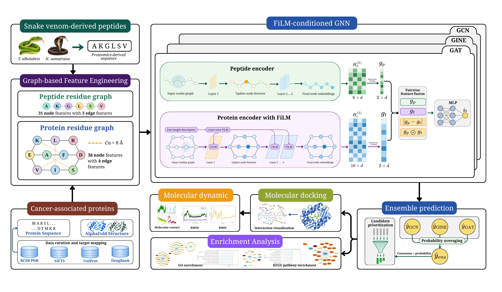

# GraphVenom: a FiLM-conditioned GNN ensemble framework for predicting cancer protein interactions with snake venom-derived peptides

GraphVenom merupakan framework komputasional untuk memprediksi dan memprioritaskan interaksi antara peptida turunan bisa ular dan protein terkait kanker. Graf tingkat residu diproses oleh GAT, GINE, dan GCN dengan pengayaan struktur protein dari AlphaFold serta pengondisian Feature-wise Linear Modulation (FiLM). Prediksi ketiga model digabungkan sebagai ensemble untuk memilih kandidat yang dikarakterisasi melalui docking, dinamika molekuler, dan pengayaan fungsional.

Repositori ini memuat data, kode, model final, dan hasil yang mendukung penelitian GraphVenom.



*Gambar 1. Alur kerja GraphVenom.*

## Struktur direktori

```text
GraphVenom/
├── README.md
├── 1-data/                        # Data peptida–protein, fitur, split, dan struktur
├── 2-machine_learning_analysis/   # Evaluasi model, GraphVenom, ablasi, dan prediksi
├── 3-docking_analysis/            # Kode, konfigurasi, skor, dan pose docking
├── 4-dynamics_analysis/           # Kurva, energi, dan gambar dinamika molekuler
└── 5-enrichment_analysis/         # Hasil enrichment GO dan KEGG per spesies
```

## Data

Data awal untuk screening meliputi peptida bisa ular dan protein terkait kanker.

| Data | Asal | Jumlah |
|---|---|---|
| Peptida *Trimeresurus albolabris* | Proteomik LC-MS sampel bisa asal Kulon Progo dari Serpentarium Universitas Gadjah Mada | 182 peptida |
| Peptida *Naja sumatrana* | Proteomik LC-MS sampel bisa asal Jambi dari Serpentarium Universitas Gadjah Mada | 829 peptida |
| Protein terkait kanker | Kurasi terintegrasi dari [RCSB PDB](https://www.rcsb.org/), [SIFTS](https://www.ebi.ac.uk/pdbe/docs/sifts/), [UniProt](https://www.uniprot.org/), dan [DrugBank](https://go.drugbank.com/) | 895 protein |

## Model Evaluation

Kode evaluasi berada di `2-machine_learning_analysis/` dengan penomoran model mengikuti artikel. Evaluasi mencakup validasi silang lima lipatan, studi ablasi, serta skenario unseen peptide, unseen protein, dan unseen both.

| Model | Metode | Sumber |
|---|---|---|
| 1 | CAMP | [Lei dkk. (2021)](https://doi.org/10.1038/s41467-021-25772-4) |
| 2 | XGBoost | [Kusuma dkk. (2023)](https://doi.org/10.1016/j.heliyon.2023.e21149) |
| 3 | ProVenTL (ProtT5 + SAE-DNN) | [Adhiva dkk. (2026)](https://doi.org/10.1007/s10822-026-00801-w) |
| 4 | ESM2 + SAE-DNN | Studi GraphVenom |
| 5 | GAT berbasis sekuens | Studi GraphVenom |
| **6** | **GraphVenom-GAT** | Studi GraphVenom |
| 7 | GINE berbasis sekuens | Studi GraphVenom |
| **8** | **GraphVenom-GINE** | Studi GraphVenom |
| 9 | GCN berbasis sekuens | Studi GraphVenom |
| **10** | **GraphVenom-GCN** | Studi GraphVenom |

**Model 6, 8, dan 10 merupakan komponen ensemble GraphVenom.** Ketiganya menggunakan graf tingkat residu dengan pengayaan struktur protein AlphaFold dan pengondisian FiLM, serta dilatih sebagai model tersendiri.

Keputusan positif ensemble memerlukan sedikitnya dua suara positif. Seleksi kandidat lanjutan menggunakan konsensus penuh dari ketiga model, kemudian pasangan diperingkat berdasarkan rata-rata probabilitas interaksi untuk memperoleh 100 kandidat teratas per spesies. Checkpoint tersedia di `2-machine_learning_analysis/checkpoints/` dan hasil evaluasi serta screening di `2-machine_learning_analysis/results/`.

## Docking

Docking kandidat dan peptida kontrol pada protein target yang sama dilakukan menggunakan HADDOCK3 ([Giulini dkk., 2025](https://doi.org/10.1021/acs.jcim.5c00969)). Interaksi antarmuka, termasuk residu kontak, ikatan hidrogen, dan jembatan garam, divisualisasikan menggunakan [Maestro 14.9, Schrödinger](https://www.schrodinger.com/platform/products/maestro/).

Lokasi data dalam `3-docking_analysis/`:

| Data | Lokasi |
|---|---|
| Kode docking | `src/` |
| Konfigurasi docking | `configs/` |
| Skor docking | `results/scores/` |
| Pose terbaik | `results/best_poses/` |
| Perbandingan kandidat dengan kontrol | `results/controls/` |
| Pemetaan hasil ke berkas input | `results/manifests/` |

Path berkas input dalam manifest dihitung dari direktori utama `GraphVenom/`.

## Dinamika molekuler

Simulasi dinamika molekuler selama 200 ns dilakukan menggunakan GROMACS 2021 ([Abraham dkk., 2015](https://doi.org/10.1016/j.softx.2015.06.001)) dengan medan gaya CHARMM36 ([Best dkk., 2012](https://doi.org/10.1021/ct300400x)). Energi pengikatan MM/PBSA dan MM/GBSA diestimasi menggunakan gmx_MMPBSA 1.6.5 ([Valdés-Tresanco dkk., 2021](https://doi.org/10.1021/acs.jctc.1c00645)).

Hasil analisis mencakup NOS2–VMEVLK, NOS2–LETHKLASLW (kontrol), PLCG1–KESEFR, dan PLCG1–QPPVPPQRPM (kontrol). Lokasi data dalam `4-dynamics_analysis/`:

| Data | Lokasi |
|---|---|
| Kurva hasil simulasi | `results/` |
| Ringkasan energi pengikatan | `results/energy_summary.csv` |
| Gambar hasil analisis | `figures/` |
| Informasi sistem | `results/systems.csv` |
| Pemetaan seri kurva | `results/series_manifest.csv` |

## Enrichment

Pengayaan fungsional protein target dianalisis menggunakan Enrichr ([Evangelista dkk., 2023](https://doi.org/10.1093/nar/gkad393)), mencakup GO Biological Process, Cellular Component, Molecular Function, dan jalur KEGG. Jejaring hubungan protein target dengan istilah GO atau jalur KEGG divisualisasikan menggunakan Cytoscape 3.10.2 ([Shannon dkk., 2003](https://doi.org/10.1101/gr.1239303)).

Lokasi hasil pengayaan dalam `5-enrichment_analysis/`:

| Data | Lokasi |
|---|---|
| Pengayaan *Naja sumatrana* | `naja_sumatrana/` |
| Pengayaan *Trimeresurus albolabris* | `trimeresurus_albolabris/` |

## Atribusi

Penelitian ini didanai oleh Lembaga Pengelola Dana Pendidikan (LPDP) atas nama Kementerian Pendidikan Tinggi, Sains, dan Teknologi Indonesia dan dikelola melalui Program EQUITY (Nomor Kontrak 4297/B3/DT.03.08/2025 dan 42011/IT3/HK.07.00-4/P/B/2025).

**Penulis:** Said Thaufik Rizaldi, Gilland Fausta Putra Achyar, Jeni Adhiva, Toto Haryanto, Rudi Heryanto, Fajar Sofyantoro, Annisa Maghfira, Donan Satria Yudha, Slamet Raharjo, Yekti Asih Purwestri, Tri Rini Nuringtyas, Ibnu Agus Ariyanto, Melva Louisa, Tamimah Shafwatul Ishlah, dan Wisnu Ananta Kusuma.

## Contact

Untuk pertanyaan, diskusi, atau informasi lebih lanjut mengenai penelitian dan penggunaan GraphVenom, silakan menghubungi:

Prof. Dr.Eng. Wisnu Ananta Kusuma, S.T., M.T.

[ananta@apps.ipb.ac.id](mailto:ananta@apps.ipb.ac.id)
